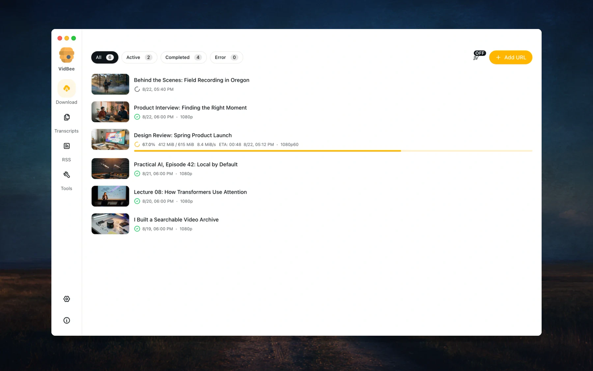
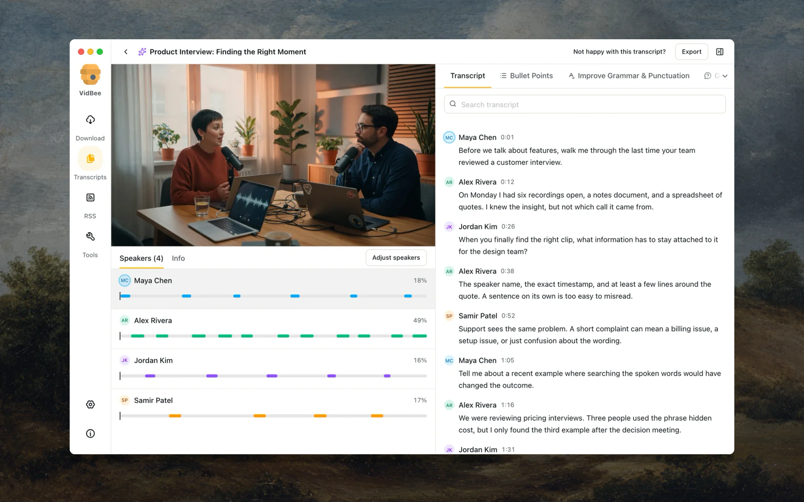

# 🚀 Beast Downloader by RV (v1.3.3)

<div align="center">
  
  <br />
  <h3><b>Beast Downloader by RV</b></h3>
  <p><b>Next-Generation High-Speed Video/Audio Downloader & Local AI Transcription Workstation</b></p>

  <p>
    <a href="https://github.com/ranjanvish/Beast-Downloader-by-RV/releases/latest"></a>
    <a href="https://github.com/ranjanvish/Beast-Downloader-by-RV/releases"></a>
    <a href="https://github.com/ranjanvish/Beast-Downloader-by-RV/blob/main/LICENSE"></a>
    <a href="https://github.com/ranjanvish/Beast-Downloader-by-RV"></a>
  </p>

  <p>
    <a href="https://github.com/ranjanvish/Beast-Downloader-by-RV/releases/download/v1.3.3/Beast-Downloader-by-RV-1.3.3-Setup.exe">
      
    </a>
  </p>
</div>

---

## ⚡ Overview

**Beast Downloader by RV** is an advanced, production-grade desktop application engineered for creators, video editors, and archivists. It combines raw multi-threaded downloading from 1000+ streaming and social platforms with on-device local AI speech recognition, precise multi-language audio selection, loss-free video trimming, and batch queues.

Built on modern **Electron 43**, **React 19**, **Tailwind CSS**, and **Drizzle SQLite**, Beast Downloader brings complete control over media extraction and analysis right to your desktop.

<div align="center">
  
  
</div>

---

## 🌟 Key Highlights & Beast Features

### 🎯 1. High-Speed Multi-Platform Downloads (1000+ Sites)
- Built on top of customized `yt-dlp` and `FFmpeg` engines with intelligent chunking.
- Full support for **YouTube (up to 4K/8K 60fps), Instagram Reels/Stories, Facebook, TikTok, X (Twitter), Twitch, Vimeo, Bilibili**, and over a thousand other media sites.
- Complete download queue management: pause, resume, reorder, auto-retry, and batch imports.

### 🌐 2. Multi-Language Audio Stream Selection (Indic & Global)
- Accurately captures separate dub tracks (Hindi, English, Spanish, Japanese, etc.) and correctly muxes them into MP4/MKV.
- Special UTF-8 preservation layer ensures international title characters and metadata never get corrupted during heavy batch processing.

### 🤖 3. Local AI Speech Transcription (No Cloud Required)
- Run speech-to-text models directly on your hardware with zero upload latency or subscription costs:
  - **Whisper** (tiny, base, small, medium, large-v3)
  - **SenseVoice** & **Parakeet**
  - **Qwen3-ASR**
- Automatic speaker diarization (speaker separation), clickable timestamps, and instant playback syncing.
- Export transcripts to SRT, VTT, Markdown, or burn them directly into the exported video.

### ✂️ 4. Precision Trimming & Lossless Merging
- Clip only the exact section you need before downloading, avoiding gigantic raw files.
- Smart re-muxing ensures zero quality loss when exporting MP4, MKV, or WebM formats.

### 📡 5. Creator RSS Automation & Subscriptions
- Follow your favorite YouTube channels, podcasts, and creator feeds.
- Automatically monitor new uploads, apply custom filters/tags, and fetch media automatically into organized folders.

### 🧩 6. Browser Extension Companion
- One-click browser integration for Chrome, Brave, and Edge via WebExtension (WXT).
- Detects media directly from your active browser tab and passes it instantly to Beast Downloader.

---

## 📥 Installation

### Option A: One-Click Windows Setup (Recommended)
1. Head over to the [Latest Release](https://github.com/ranjanvish/Beast-Downloader-by-RV/releases/latest).
2. Download **`Beast-Downloader-by-RV-1.3.3-Setup.exe`**.
3. Run the installer and launch **Beast Downloader by RV** from your Desktop or Start Menu.

### Option B: Build from Source

#### Prerequisites
- **Node.js**: v24.x or v22.x LTS
- **pnpm**: v11.1.2 or higher (`npm install -g pnpm@11.1.2`)
- **Git**

#### Steps
```bash
# 1. Clone repository
git clone https://github.com/ranjanvish/Beast-Downloader-by-RV.git
cd Beast-Downloader-by-RV

# 2. Install workspace dependencies (using hoisted linker for native compatibility)
pnpm install --node-linker=hoisted

# 3. Build the browser companion extension
pnpm --filter vidbee-extension build

# 4. Run the regression test suite
node --test apps/desktop/scripts/test-beast-regressions.cjs

# 5. Launch in development mode
pnpm --filter beast-downloader dev

# 6. Package Windows NSIS x64 Installer
pnpm --filter beast-downloader build:win
```

The compiled installer will be located in `apps/desktop/dist/Beast-Downloader-by-RV-1.3.3-Setup.exe`.

---

## 🏛️ Monorepo Structure

```text
Beast-Downloader-by-RV/
├── apps/
│   ├── desktop/          # Electron 43 + React 19 desktop application
│   ├── extension/        # Browser companion extension (Chrome / Brave / Edge)
│   ├── api/              # Fastify headless API server with oRPC & SSE
│   ├── web/              # TanStack Start web interface
│   └── cli/              # Command-line interface tool
├── packages/
│   ├── downloader-core/  # yt-dlp & FFmpeg execution wrapper
│   ├── transcription/    # Local AI ASR engine (Whisper, SenseVoice, sherpa-onnx)
│   ├── task-queue/       # Robust job classifier & priority queue
│   ├── subscriptions-core/# RSS parser and feed coordinator
│   ├── db/               # Drizzle ORM schema & SQLite migration layer
│   ├── logger/           # Structured logging
│   └── ui/               # Shared Radix UI & Tailwind component library
└── screenshots/          # Application previews and UI captures
```

---

## 🛠️ Technology Stack

- **Runtime & Desktop Framework**: Electron 43, Node.js 24
- **Frontend**: React 19, TypeScript, Tailwind CSS, Lucide Icons, Shadcn UI
- **Local Database**: SQLite with Drizzle ORM
- **Media Engine**: yt-dlp, FFmpeg, ImageMagick
- **AI / Speech Engine**: sherpa-onnx, whisper.cpp, fast-whisper
- **Packager**: electron-builder, NSIS 3.13

---

## 🤝 Credits & Acknowledgements

- Built upon the foundation of [VidBee](https://github.com/nexmoe/VidBee) by nexmoe.
- Powered by [yt-dlp](https://github.com/yt-dlp/yt-dlp) and [FFmpeg](https://ffmpeg.org/).
- Customized & maintained by **RV (Ranjan Vishwakarma)**.

---

## 📄 License

This project is licensed under the [MIT License](LICENSE).
