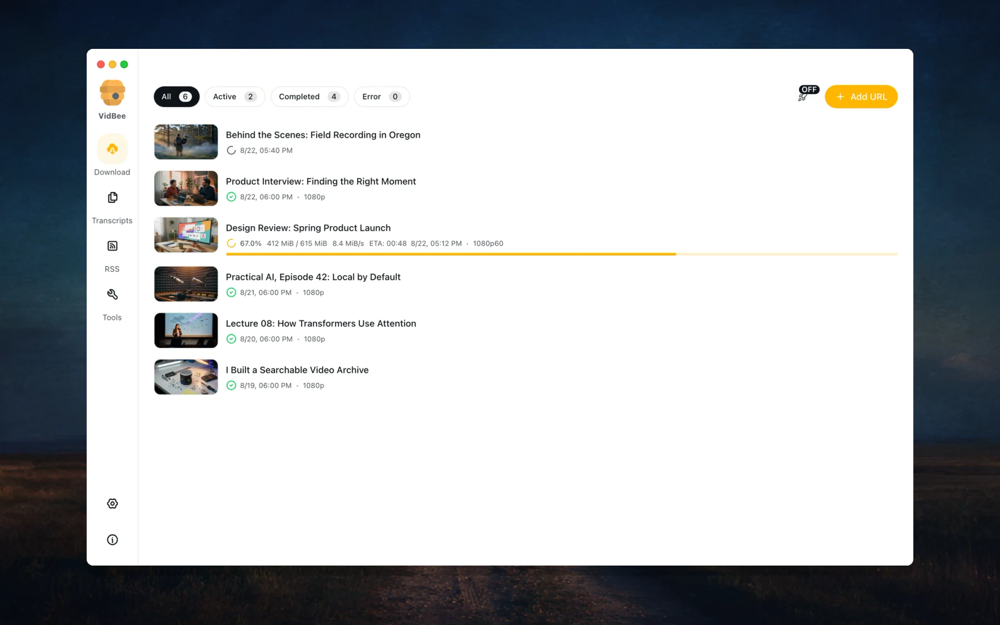
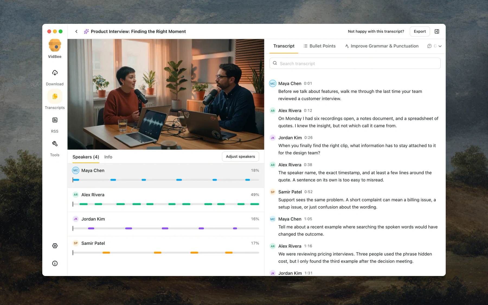

# 🚀 Beast Downloader by RV (v3.1.9 Latest)

<div align="center">
  
  <br />
  <h3><b>Beast Downloader by RV</b></h3>
  <p><b>Next-Generation High-Speed Video/Audio/Image Downloader, Local AI Transcription & Media Workspace</b></p>

  <p>
    <a href="https://github.com/ranjanvish/Beast-Downloader-by-RV/releases/latest"></a>
    <a href="https://github.com/ranjanvish/Beast-Downloader-by-RV/releases"></a>
    <a href="https://github.com/ranjanvish/Beast-Downloader-by-RV/blob/main/LICENSE"></a>
    <a href="https://github.com/ranjanvish/Beast-Downloader-by-RV"></a>
  </p>

  <p>
    <a href="https://github.com/ranjanvish/Beast-Downloader-by-RV/releases/download/v3.1.9/Beast-Downloader-by-RV-3.1.9-Setup.exe">
      
    </a>
  </p>
</div>

---

## ⚡ Overview

**Beast Downloader by RV (v3.1.9)** is a powerful, production-grade media downloader and workstation built specifically for content creators, video editors, and archivists. It integrates multi-threaded downloading from 1000+ video, audio, and image platforms with on-device local AI speech recognition, precise multi-language audio selection, loss-free video trimming, and a high-speed local updates development loop.

Built with **Electron 43**, **React 19**, **Tailwind CSS**, and **Drizzle SQLite**, Beast Downloader brings full studio-grade media processing directly onto your local machine.

<div align="center">
  
  
</div>

---

## 🌟 What's New & Upgraded in v3.1.9

### 🔥 1. Instant Local Updates Engine
- **FastBuild & Hot Reloading** (`FastBuild.cmd`, `WatchUpdates.ps1`): Replaces compiled application code (`app.asar`) in seconds without reinstalling the entire Electron runtime or terminating running background downloads.
- **Fail-safe Rollback**: Automatically verifies builds, updates patch versions, and preserves installed working code if any validation check fails.

### 🎬 2. Unified Beast Download Workspace
- **SingleVideoBeast**: Dedicated precision inspector for high-resolution video streams (4K/8K 60fps), audio dub tracks, and metadata.
- **BeastClip**: Precision interactive timeline trimming. Download only the exact seconds/minutes you need without fetching multi-gigabyte source files.
- **AllInOneDownloads**: Unified multi-tab queue orchestrating video, audio, and image tasks in parallel.

### 🖼️ 3. Batch Image Downloader & Converter
- Built-in crawler extracting high-resolution images from supported galleries, web pages, and social media.
- Integrated **ImageMagick** conversion engine allowing instant WebP, PNG, and JPG optimization and format conversions.

### 🌐 4. Zero-Loss Multi-Language Audio Stream Selection
- Accurately captures separate audio dub tracks (Hindi, English, Spanish, Japanese, etc.) and muxes them seamlessly into MP4 or MKV containers.
- Enhanced UTF-8 preservation layer keeps international and Indic characters intact without filename corruption.

### 🤖 5. On-Device Local AI Speech Transcription
- Integrated speech-to-text models that run 100% locally with zero subscription costs or cloud latency:
  - **Whisper** (tiny, base, small, medium, large-v3)
  - **SenseVoice** & **Parakeet**
  - **Qwen3-ASR**
- Automatic speaker diarization, clickable timestamp jump, and SRT/VTT/Markdown export.

### 🧩 6. Browser Extension Companion (Chrome / Brave / Edge)
- Built on modern Manifest V3 (WXT) with instant media overlay detection.
- Send active video, audio, or image galleries from your browser into Beast Downloader in a single click.

---

## 📥 Installation

### Option A: One-Click Windows Setup (Recommended)
1. Go to the [Latest Release (v3.1.9)](https://github.com/ranjanvish/Beast-Downloader-by-RV/releases/tag/v3.1.9).
2. Download **`Beast-Downloader-by-RV-3.1.9-Setup.exe`**.
3. Run the installer to install or upgrade Beast Downloader.

### Option B: Build from Source

#### Prerequisites
- **Node.js**: v24.x or v22.x LTS
- **pnpm**: v11.1.2 or higher (`npm install -g pnpm@11.1.2`)
- **Git**

#### Steps
```bash
# 1. Clone repository
git clone https://github.com/ranjanvish/Beast-Downloader-by-RV.git
cd Beast-Downloader-by-RV

# 2. Install workspace dependencies
pnpm install --node-linker=hoisted

# 3. Build the browser extension companion
pnpm --filter vidbee-extension build

# 4. Run the regression test suite
node --test apps/desktop/scripts/test-beast-regressions.cjs

# 5. Build & Launch in development mode
pnpm --filter beast-downloader dev

# 6. Package Windows NSIS x64 Installer
pnpm --filter beast-downloader build:win
```

---

## 🏛️ Monorepo Architecture

```text
Beast-Downloader-by-RV/
├── apps/
│   ├── desktop/          # Electron 43 + React 19 desktop workstation (v3.1.9)
│   ├── extension/        # Browser companion extension (Chrome / Brave / Edge MV3)
│   ├── api/              # Fastify headless API server with oRPC & SSE
│   ├── web/              # TanStack Start web interface
│   └── cli/              # Command-line interface tool
├── packages/
│   ├── downloader-core/  # yt-dlp & FFmpeg execution wrapper + editor-video pipeline
│   ├── transcription/    # Local AI ASR engine (Whisper, SenseVoice, sherpa-onnx)
│   ├── task-queue/       # Robust job classifier & priority queue
│   ├── subscriptions-core/# RSS parser and feed coordinator
│   ├── db/               # Drizzle ORM schema & SQLite migration layer
│   ├── logger/           # Structured logging
│   └── ui/               # Shared Radix UI & Tailwind component library
├── FastBuild.cmd         # Quick 1-click local development build & hot-update
├── WatchUpdates.ps1      # Background source watcher for seamless updates
└── screenshots/          # Application previews and UI captures
```

---

## 🛠️ Technology Stack

- **Desktop Framework**: Electron 43, Node.js 24
- **Frontend**: React 19, TypeScript, Tailwind CSS, Lucide Icons, Shadcn UI
- **Database**: SQLite with Drizzle ORM
- **Media Engine**: yt-dlp, FFmpeg, ImageMagick
- **ASR AI Engine**: sherpa-onnx, whisper.cpp, fast-whisper
- **Packager**: electron-builder 26, NSIS 3.12

---

## 🤝 Credits & Acknowledgements

- Built upon the foundation of [VidBee](https://github.com/nexmoe/VidBee) by nexmoe.
- Powered by [yt-dlp](https://github.com/yt-dlp/yt-dlp) and [FFmpeg](https://ffmpeg.org/).
- Customized & maintained by **RV (Ranjan Vishwakarma)**.

---

## 📄 License

This project is licensed under the [MIT License](LICENSE).
